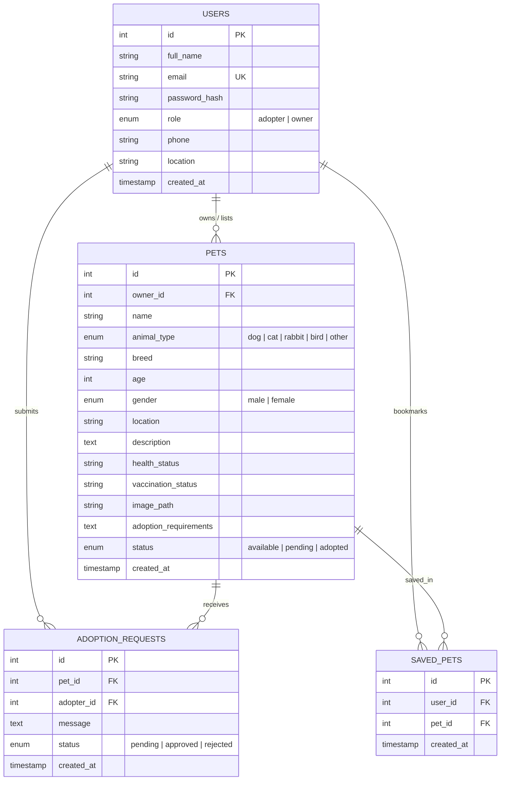

# PawNest — Pet Adoption Management System

> A complete, production-grade Pet Adoption Management System built with **HTML5, CSS3, JavaScript, Node.js, Express.js, and MySQL (mysql2)**. Designed for college full-stack lab internals and real-world pet rescue operations.

---

## 📑 Table of Contents
1. [Project Overview](#project-overview)
2. [Key Features](#key-features)
3. [Technology Stack](#technology-stack)
4. [Project Structure](#project-structure)
5. [Database Design & Schema](#database-design--schema)
6. [Installation & Setup Guide](#installation--setup-guide)
7. [Running the Application](#running-the-application)
8. [Automated Testing & Results](#automated-testing--results)
9. [RESTful API Documentation](#restful-api-documentation)
10. [Demo User Credentials](#demo-user-credentials)
11. [Lab Viva Voce Preparation Guide](#lab-viva-voce-preparation-guide)

---

## 1. Project Overview

**PawNest** connects prospective pet adopters with animal shelters, foster parents, and pet owners looking to rehome pets ethically. 

### Why PawNest?
- Eliminates unethical breeding by verifying listings and medical records.
- Provides a transparent, end-to-end adoption request pipeline.
- Offers dedicated dashboards tailored to **Adopters** and **Pet Owners / Shelters**.

---

## 2. Key Features

- **Dynamic Homepage**: Hero showcase, verified adoption metrics, search filters, pet species pills, step-by-step adoption workflow, and shelter onboarding banner.
- **Advanced Pet Filtering**: Filter by animal type (Dog, Cat, Rabbit, Bird, Other), breed, age range, gender, location, availability status, and keyword search.
- **Pet Profile & Medical Records**: Detailed bios, vaccination logs, microchip details, health history, and owner contact information.
- **Secure Authentication (JWT & Bcrypt)**: Password hashing with 10 salt rounds, JWT session handling, role enforcement (`adopter` vs `owner`).
- **Owner / Shelter Dashboard**:
  - Live statistics: Total listings, active listings, adopted count, pending applications.
  - CRUD operations: Add new pet with image upload, edit listings, and delete listings.
  - Application manager: Review adopter notes, Approve (marks pet adopted!) or Reject applications.
- **Adopter Dashboard**:
  - Track submitted adoption requests with real-time status badges (Pending, Approved, Rejected).
  - Saved pets (favorites/bookmarks) management.
- **Secure Image Uploads**: Multer middleware with safe randomized filenames, mime-type verification, 5MB limit, and attractive SVG fallbacks.
- **1-Click Demo Login**: Pre-configured buttons on the login page for instant lab evaluations.

---

## 3. Technology Stack

| Layer | Technologies Used |
|---|---|
| **Frontend** | HTML5, CSS3 (Custom Design Tokens, Responsive Flexbox/Grid, Micro-animations), Vanilla ES6+ JavaScript |
| **Backend** | Node.js (v24), Express.js (REST API architecture) |
| **Database** | MySQL Server 8.0, `mysql2/promise` connection pool |
| **Authentication** | JSON Web Tokens (`jsonwebtoken`), `bcryptjs` (salt rounds: 10) |
| **Validation** | `express-validator` middleware for route input sanitation |
| **File Handling** | `multer` for secure multipart/form-data image uploads |
| **Testing** | Node.js native test runner (`node:test`, `node:assert/strict`) & `supertest` |

---

## 4. Project Structure

```text
pawnest/
├── .env                      # Active environment variables (DB credentials, JWT secret)
├── .env.example              # Template environment file
├── .gitignore                # Git exclusions (node_modules, .env, uploads)
├── package.json              # Dependencies and lifecycle scripts
├── server.js                 # Express application entrypoint
├── database.sql              # MySQL DDL schema and demo seed records
├── config/
│   └── db.js                 # MySQL2 connection pool and parameterized query helper
├── controllers/
│   ├── authController.js     # User registration, login, and profile updates
│   ├── petController.js      # Pet listings CRUD, filtering, and owner views
│   ├── adoptionController.js # Adoption applications lifecycle & transactions
│   └── savedPetController.js # Favorites / bookmarks management
├── middleware/
│   ├── authMiddleware.js     # JWT verification and role-based access control
│   ├── errorMiddleware.js    # Centralized error and 404 handlers
│   └── uploadMiddleware.js   # Multer file upload configuration and validation
├── routes/
│   ├── authRoutes.js         # Authentication REST endpoints
│   ├── petRoutes.js          # Pet listings REST endpoints
│   ├── adoptionRoutes.js     # Adoption request REST endpoints
│   └── savedPetRoutes.js     # Saved pets REST endpoints
├── public/                   # Frontend assets
│   ├── index.html            # Landing / Home page
│   ├── pets.html             # Browse adoptable pets page
│   ├── pet-details.html      # Pet profile & adoption request page
│   ├── login.html            # Login page (with 1-click lab demo accounts)
│   ├── register.html         # User registration page
│   ├── adopter-dashboard.html# Adopter dashboard (Applications & Saved Pets)
│   ├── owner-dashboard.html  # Shelter dashboard (Metrics, Listings, Applications)
│   ├── add-pet.html          # Add / Edit pet listing form
│   ├── profile.html          # User profile & password management
│   ├── about.html            # About PawNest mission & values
│   ├── contact.html          # Contact form & FAQ
│   ├── guidelines.html       # Adoption checklist & 3-3-3 rule guide
│   ├── css/
│   │   └── style.css         # Custom design tokens, components, responsive layout
│   └── js/
│       ├── app.js            # Global auth session, dynamic navbar, toasts, apiFetch
│       ├── auth.js           # Login & register client handlers
│       ├── pets.js           # Browse page filtering & pagination
│       ├── pet-details.js    # Pet detail rendering & application submission
│       ├── dashboard.js      # Dashboards controller (listings, requests)
│       ├── add-pet.js        # Add/edit listing controller with live image preview
│       └── profile.js        # Profile editing & password change
├── uploads/                  # Uploaded pet images & demo photos
├── scripts/
│   ├── init-db.js            # Database creation & SQL seeder script
│   └── download-demo-assets.js # Demo assets downloader
└── tests/
    └── api.test.js           # 19 automated integration and unit tests
```

---

## 5. Database Design & Schema

### Database: `pawnest_db`



### Referential Integrity & Constraints
- `ON DELETE CASCADE`: If a user or pet is deleted, associated adoption requests and bookmarks are automatically removed.
- `UNIQUE KEY unique_user_pet_save (user_id, pet_id)`: Prevents duplicate bookmarks.
- Transactional integrity on adoption approvals: Approving an adoption request automatically updates the pet's status to `adopted` inside a database transaction.

---

## 6. Installation & Setup Guide

### Prerequisites
- **Node.js** (v18 or higher recommended; tested on v24)
- **MySQL Server** (v8.0; running on `localhost:3306`)

### Step 1: Install Dependencies
```bash
npm install
```

### Step 2: Configure Environment Variables
Verify or edit `.env` in the root folder:
```env
PORT=3000
NODE_ENV=development

# MySQL Database Configuration
DB_HOST=localhost
DB_PORT=3306
DB_USER=root
DB_PASSWORD=root
DB_NAME=pawnest_db

# Security & Authentication
JWT_SECRET=pawnest_super_secret_jwt_key_2026_pet_adoption_lab
JWT_EXPIRES_IN=7d
```

### Step 3: Initialize Database Schema & Seed Data
Execute the automated database initializer:
```bash
npm run db:init
```
*(Creates the `pawnest_db` database, generates all tables with foreign keys, and seeds sample pets and users).*

---

## 7. Running the Application

### Start the Server:
```bash
npm start
```
Or with auto-reload during development:
```bash
npm run dev
```

### Open in Browser:
- **Landing Page**: [http://localhost:3000/index.html](http://localhost:3000/index.html)
- **Browse Pets**: [http://localhost:3000/pets.html](http://localhost:3000/pets.html)
- **Login Page**: [http://localhost:3000/login.html](http://localhost:3000/login.html)
- **API Health Check**: [http://localhost:3000/api/health](http://localhost:3000/api/health)

---

## 8. Automated Testing & Results

Run the full automated test suite using Node's native runner:
```bash
npm test
```

### Actual Test Run Results:
```text
▶ PawNest Comprehensive Backend API & Database Test Suite
  ✔ 1. Health Check Endpoint (61ms)
  ✔ 2. Authentication: User Registration and Password Hashing (210ms)
  ✔ 3. Authentication: Reject Duplicate Email Registration (11ms)
  ✔ 4. Authentication: Reject Invalid Inputs (Validation) (7ms)
  ✔ 5. Authentication: User Login with Seeded Owner (260ms)
  ✔ 6. Authentication: Reject Invalid Password (132ms)
  ✔ 7. Authentication: GET /api/auth/me Protected Profile (10ms)
  ✔ 8. Pets: Browse Pets with Search & Filters (21ms)
  ✔ 9. Pets: Get Pet By ID & Handle 404 for Nonexistent Pet (19ms)
  ✔ 10. Pets: Owner Creates New Pet Listing (22ms)
  ✔ 11. Pets: Adopter Cannot Create Pet Listing (Role Protection) (7ms)
  ✔ 12. Pets: Owner Updates Their Own Pet Listing (15ms)
  ✔ 13. Pets: Unauthorized Owner Cannot Modify Another Owner's Pet Listing (9ms)
  ✔ 14. Adoption Requests: Adopter Submits Request (14ms)
  ✔ 15. Adoption Requests: Prevent Duplicate Active Request for Same Pet (8ms)
  ✔ 16. Adoption Requests: Adopter Views Their Requests (10ms)
  ✔ 17. Adoption Requests: Owner Reviews Received Requests & Approves (38ms)
  ✔ 18. Saved Pets: Add, Get, and Remove Bookmark (31ms)
  ✔ 19. Pets: Owner Deletes Their Pet Listing (15ms)
✔ PawNest Comprehensive Backend API & Database Test Suite (914ms)

tests: 19 | passed: 19 | failed: 0 | cancelled: 0
```

---

## 9. RESTful API Documentation

### Authentication Endpoints (`/api/auth`)

#### `POST /api/auth/register`
- **Description**: Registers a new user account.
- **Request Body**:
```json
{
  "full_name": "Alex Morgan",
  "email": "alex@example.com",
  "password": "Password123!",
  "role": "adopter",
  "location": "New York, NY",
  "phone": "555-014-3829"
}
```
- **Response** (`201 Created`):
```json
{
  "success": true,
  "message": "Account registered successfully!",
  "token": "eyJhbGciOiJIUzI1NiIsInR5cCI6IkpXVCJ9...",
  "user": {
    "id": 5,
    "full_name": "Alex Morgan",
    "email": "alex@example.com",
    "role": "adopter",
    "location": "New York, NY"
  }
}
```

#### `POST /api/auth/login`
- **Description**: Authenticates user and returns JWT token.
- **Request Body**:
```json
{
  "email": "owner@pawnest.com",
  "password": "Password123!"
}
```
- **Response** (`200 OK`):
```json
{
  "success": true,
  "message": "Login successful!",
  "token": "eyJhbGciOiJIUzI1NiIsInR5cCI6IkpXVCJ9...",
  "user": {
    "id": 1,
    "full_name": "Sarah Jenkins (Happy Tails Shelter)",
    "email": "owner@pawnest.com",
    "role": "owner"
  }
}
```

---

### Pet Endpoints (`/api/pets`)

#### `GET /api/pets`
- **Query Parameters**: `animal_type`, `breed`, `gender`, `location`, `status`, `search`, `sort`, `page`, `limit`
- **Response** (`200 OK`):
```json
{
  "success": true,
  "data": [
    {
      "id": 1,
      "name": "Buddy",
      "animal_type": "dog",
      "breed": "Golden Retriever",
      "age": 2,
      "gender": "male",
      "location": "New York, NY",
      "status": "available",
      "owner_name": "Sarah Jenkins (Happy Tails Shelter)",
      "is_saved": false
    }
  ],
  "pagination": { "total": 8, "page": 1, "limit": 12, "totalPages": 1 }
}
```

#### `POST /api/pets` (Owner Role Required)
- **Content-Type**: `multipart/form-data`
- **Fields**: `name`, `animal_type`, `breed`, `age`, `gender`, `location`, `description`, `health_status`, `vaccination_status`, `adoption_requirements`, `image` (file)
- **Response** (`201 Created`):
```json
{
  "success": true,
  "message": "Pet listing created successfully!",
  "data": { "id": 9, "name": "Barnaby", "status": "available" }
}
```

#### `PUT /api/pets/:id` (Owner of this pet only)
- **Description**: Updates pet details or changes status (`available`, `pending`, `adopted`).

#### `DELETE /api/pets/:id` (Owner of this pet only)
- **Description**: Permanently removes pet listing.

---

### Adoption Request Endpoints (`/api/adoption-requests`)

#### `POST /api/adoption-requests` (Adopter Role Required)
- **Request Body**:
```json
{
  "pet_id": 1,
  "message": "I would love to adopt Buddy! I have a dog-friendly house with a big backyard."
}
```
- **Response** (`201 Created`):
```json
{
  "success": true,
  "message": "Your adoption request for Buddy has been submitted successfully!",
  "data": { "id": 3, "pet_id": 1, "status": "pending" }
}
```

#### `GET /api/adoption-requests/my` (Adopter Role)
- **Description**: Returns all requests submitted by the logged-in adopter.

#### `GET /api/adoption-requests/received` (Owner Role)
- **Description**: Returns all requests received for pets listed by this owner.

#### `PATCH /api/adoption-requests/:id/status` (Owner Role)
- **Request Body**: `{ "status": "approved" }` or `{ "status": "rejected" }`
- **Response** (`200 OK`): Approves application and automatically marks pet as `adopted`.

---

### Saved Pets Endpoints (`/api/saved-pets`)

- `GET /api/saved-pets`: List bookmarked pets.
- `POST /api/saved-pets/:petId`: Add pet to saved list.
- `DELETE /api/saved-pets/:petId`: Remove pet from saved list.

---

## 10. Demo User Credentials

For testing and lab demonstration, the database includes pre-configured accounts:

| Role | Name | Email | Password |
|---|---|---|---|
| **Shelter / Owner** | Sarah Jenkins (Happy Tails) | `owner@pawnest.com` | `Password123!` |
| **Shelter / Owner 2** | David Miller (Rescue Haven) | `david@pawnest.com` | `Password123!` |
| **Adopter** | Alex Morgan | `adopter@pawnest.com` | `Password123!` |
| **Adopter 2** | Priya Sharma | `priya@pawnest.com` | `Password123!` |

*(On the login page, you can also click the quick-fill buttons for instant 1-click credentials).*

---

## 11. Lab Viva Voce Preparation Guide

### Q1: What is Node.js and how does it execute JavaScript on the server?
> **Answer**: Node.js is an open-source, cross-platform JavaScript runtime built on Google Chrome's V8 engine. It uses an **event-driven, non-blocking I/O model**, allowing it to handle concurrent network requests efficiently on a single thread via the **Event Loop**.

### Q2: What is Express.js and what role does it play?
> **Answer**: Express.js is a minimal and flexible web application framework for Node.js. It simplifies routing, middleware integration, HTTP request handling, response formatting, and static file serving.

### Q3: What is `express.json()` and why is it necessary?
> **Answer**: `express.json()` is built-in middleware based on `body-parser`. Incoming HTTP requests with JSON payloads arrive as raw TCP data streams. `express.json()` intercepts incoming requests with the `Content-Type: application/json` header, parses the stream, and populates `req.body` as a native JavaScript object.

### Q4: What are Middleware functions in Express?
> **Answer**: Middleware functions are functions that have access to the request object (`req`), the response object (`res`), and the `next` middleware function in the application’s request-response cycle. They can execute code, modify `req` and `res`, end the request-response cycle, or call `next()` to pass control to the next handler. Examples in PawNest: `authenticateUser`, `uploadPetImage`, `errorHandler`.

### Q5: What is a RESTful API?
> **Answer**: REpresentational State Transfer (REST) is an architectural style for networked systems. In REST:
> - Resources are identified by standard URI paths (e.g. `/api/pets`).
> - Standard HTTP verbs represent actions:
>   - `GET`: Retrieve resource
>   - `POST`: Create resource
>   - `PUT`: Replace / update full resource
>   - `PATCH`: Partially update resource
>   - `DELETE`: Remove resource
> - Communication is stateless and responses return standard HTTP status codes (200, 201, 400, 401, 403, 404, 500).

### Q6: How does PawNest prevent SQL Injection?
> **Answer**: PawNest strictly uses **Parameterized Queries** via `mysql2/promise` (`pool.execute('SELECT * FROM users WHERE email = ?', [email])`). In parameterized queries, user inputs are sent as parameters separated from the SQL command structure. The database engine treats them as literal data, completely preventing malicious SQL command injection.

### Q7: How is Password Security implemented?
> **Answer**: Passwords are never stored in plaintext. PawNest uses `bcryptjs` with a work factor of 10 rounds. Bcrypt automatically generates a cryptographic salt and hashes the password with a one-way mathematical function. When logging in, `bcrypt.compare()` compares the plain password with the stored hash securely without ever decrypting it.

### Q8: How does JWT Authentication work?
> **Answer**: 
> 1. When a user logs in, the server generates a cryptographically signed JSON Web Token using `jwt.sign({ id, email, role }, JWT_SECRET, { expiresIn: '7d' })`.
> 2. The client receives the token and stores it securely.
> 3. For protected requests, the client transmits the token in the `Authorization: Bearer <token>` header.
> 4. The `authenticateUser` middleware verifies the digital signature using `jwt.verify()`. If valid, it extracts the user ID and attaches `req.user`.

### Q9: What are Foreign Keys and Cascading Constraints in MySQL?
> **Answer**: A Foreign Key is a field in one table that uniquely identifies a row in another table, enforcing referential integrity.
> In PawNest, `pets.owner_id` references `users.id` with `ON DELETE CASCADE`. If a user is deleted from the database, MySQL automatically deletes all pets and adoption applications created by that user to avoid orphaned records.

### Q10: How are Image Uploads handled safely in development vs production?
> **Answer**:
> - **In Development (Current)**: Files are handled by `multer.diskStorage()`. File types are validated using MIME checks (`image/jpeg`, `image/png`, etc.), file sizes are restricted to 5MB, and filenames are randomized with timestamps and crypto hex strings to prevent file collisions or executable upload exploits. Files are stored in the local `/uploads` directory and served statically.
> - **In Production**: In cloud production environments (like AWS or GCP), local disk storage is ephemeral across server restarts or multiple container instances. Uploads would be streamed directly to an object storage service such as **Amazon S3** or **Google Cloud Storage** via a signed URL or CDN (CloudFront / Cloudflare).

---

## 12. License
Created for Academic Lab Demonstration and Educational Evaluation. Open Source MIT.
